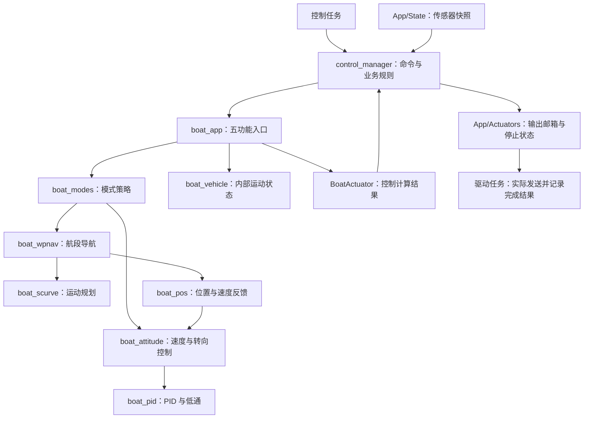

# 应用控制模块

`control_manager` 负责命令、模式切换、目标变化、到点处理和返航规则。`Boat/` 负责五功能控制计算。只有控制任务访问这两层的可变状态；任务把传感器快照和当前毫秒时间传入，得到控制结果，再交给驱动任务发送。

```text
App/Control/
├─ control_manager.c/.h       命令与控制业务编排
├─ README.md                 本模块的职责和依赖约束
└─ Boat/                     原 User/boat 的 19 个纯 C 算法文件
   ├─ boat_app.c/.h          五功能入口、输入适配和输出转换
   ├─ boat_modes.c/.h        闭环模式策略及锚点、锁定航向状态
   ├─ boat_wpnav.c/.h        航段、航迹误差、到点与 Pivot
   ├─ boat_scurve.c/.h       航段运动规划
   ├─ boat_pos.c/.h          位置和速度误差计算
   ├─ boat_attitude.c/.h     航向、转向角速度和速度控制
   ├─ boat_pid.c/.h          PID、积分限制及误差低通滤波
   ├─ boat_vehicle.c/.h      算法内部的运动状态
   ├─ boat_math.c/.h         坐标、角度和限幅工具
   └─ boat_config.h          唯一的算法参数定义
```

## 现有职责如何划分

| 文件 | 留在控制模块的原因与边界 |
|---|---|
| `control_manager` | 将接收命令、传感器保护和返航判定组合成有效控制模式；与 `boat_app` 的计算入口职责不同。 |
| `boat_app` | 把 `BoatSense` 转为算法输入，进入或更新模式，转换油门/转向结果与诊断。定速巡航的开环输出也在此处。 |
| `boat_modes` | 导航、稳泊、定向和航迹保持策略；锚点和锁定航向只由当前控制实例使用。 |
| `boat_wpnav` / `boat_scurve` / `boat_pos` | 共同完成导航与航迹保持的航段规划、位置反馈、速度/加速度前馈和转弯处理。两个模式共用当前航段状态。 |
| `boat_attitude` / `boat_pid` | 航向 P、速度和角速度 PID、前馈与输出限制；不接收串口帧，也不发送驱动报文。 |
| `boat_vehicle` | 保存一次计算所用的位置、航向、速度等状态；不是传感器驱动，也不是跨任务共享快照。 |
| `boat_math` | 纯数学计算，依赖标准 C 库和算法参数。 |
| `boat_config` | 保持调参来源唯一；RTOS 栈、任务周期、队列大小等仍由 `App/Config` 管理。 |



## 为什么先整体迁移

当前 19 个算法文件已按职责拆分，共享的控制状态由一个控制任务串行使用。整体归入 `App/Control/Boat` 后，业务与算法的位置统一，原来的模块边界仍然清楚。把位置计算移入 Sensors、把油门计算移入 Actuators、把 `boat_vehicle` 移入 State，会让一轮计算的内部状态与硬件或跨任务状态混在一起。

当前不再为每个算法建立文件夹，也不把每种模式都拆成任务。后续若 `boat_modes` 的模式策略显著增长，可在 `Boat` 内拆成各模式文件，并通过显式模式状态传递锚点、锁定航向和航段信息；拆分前先固定模式进入、重置、完成和恢复行为，避免增加第二套状态或五套 PID。现在没有重复实现的五功能控制器需要合并。

## 迁移与验证

19 个 `.c/.h` 文件从 `User/boat` 移到 `App/Control/Boat`，迁移时内容逐字保留；随后按用户要求补充中文注释并修正旧目录/调用说明，算法参数和 C 代码 token 与旧版本一致。Keil 编译组、头文件路径、主机测试和目录检查同步更新。旧位置不保留第二份实现。`tests/fixtures/legacy` 与其 SHA256 清单仍记录重构前位置和原始字节，检查工具先验证冻结原件的 SHA256，再比较当前文件的代码 token。

当前源码中旧 `User/boat`、`main` 配置外设或 `HAL_GetTick` 的说明已修正；冻结的测试基准保留历史文字。`BoatApp_Update` 的时间由调用方传入，算法不调用 HAL 或 FreeRTOS。

复核入口：`tools/verify_comments.py`、`tests/run_host_tests.py`、`tests/control/compare_legacy.py`、`tools/build_keil.ps1`、`tools/verify_layout.py`。主机与编译检查不能替代上板验收。
