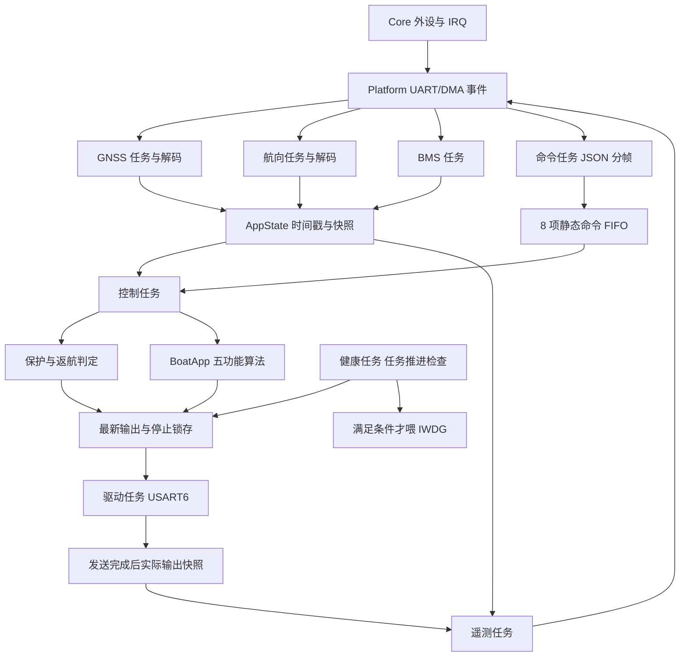
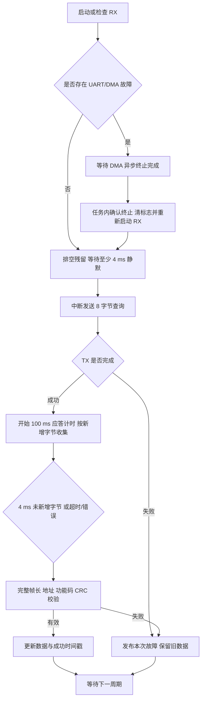
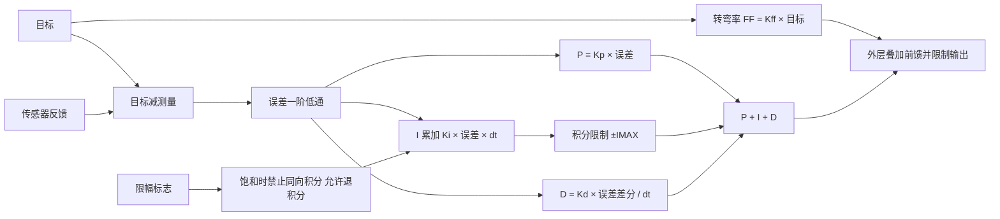

# STM32F405RGT6 FreeRTOS 重构方案与实现说明

更新日期：2026-10-10。工程位置：`E:\无人船\STM32F405RGT6`。

本次已落实目录、FreeRTOS 内核、八个静态任务、共享快照、独立传感器采集、命令队列、驱动输出与健康监测。五功能算法逻辑及参数保持原样，定速巡航仍为开环油门；源码已补充中文注释，代码 token 与冻结基准一致。本文记录目标设计和当前实现；上板及实船验收项目单独列出，不能以编译或主机测试代替。

## 1. 工程目录与各文件夹用途

```text
E:\无人船\
├─ STM32F405RGT6_FreeRTOS重构方案.md
├─ ardupilot/                         算法来源参考，不参与本固件编译
└─ STM32F405RGT6/
   ├─ Core/
   │  ├─ Inc/
   │  └─ Src/
   ├─ Drivers/
   │  ├─ CMSIS/
   │  └─ STM32F4xx_HAL_Driver/
   ├─ Middlewares/
   │  └─ Third_Party/
   │     ├─ FreeRTOS/
   │     │  └─ Source/
   │     │     ├─ include/
   │     │     └─ portable/
   │     │        ├─ GCC/ARM_CM4F/
   │     │        └─ MemMang/
   │     └─ cJSON/
   ├─ Platform/
   │  ├─ Inc/
   │  └─ Src/
   ├─ App/
   │  ├─ Config/
   │  ├─ Tasks/
   │  ├─ State/
   │  ├─ Control/
   │  │  └─ Boat/                    五功能纯 C 控制模块
   │  ├─ Sensors/
   │  ├─ Protocol/
   │  ├─ Actuators/
   │  ├─ Safety/
   │  └─ Diagnostics/
   ├─ MDK-ARM/
   │  ├─ Objects/
   │  └─ Listings/
   ├─ tests/
   │  ├─ control/
   │  ├─ sensors/
   │  ├─ transport/
   │  ├─ protocol/
   │  ├─ safety/
   │  ├─ integration/
   │  ├─ mocks/
   │  └─ fixtures/legacy/
   ├─ docs/
   │  ├─ architecture/
   │  ├─ sensors/
   │  ├─ protocol/
   │  ├─ validation/
   │  └─ gnss/
   └─ tools/
```

### 基础工程和第三方源码

| 目录 | 存什么 | 有什么作用 |
|---|---|---|
| `Core` | MCU 启动和外设初始化代码 | 保持 STM32 基础工程结构，业务不再集中在 main 中。 |
| `Core/Inc` | GPIO、UART、IWDG、中断等头文件 | 声明硬件初始化接口。 |
| `Core/Src` | main、时钟、GPIO、UART、MSP、IRQ、TIM6 HAL 时基等 | main 完成外设初始化、上电零输出和调度器启动；IRQ 转交板级模块。 |
| `Drivers` | 厂商代码 | 不混入应用实现。 |
| `Drivers/CMSIS` | 内核与芯片定义 | 为 Cortex-M4F 和 STM32F405 提供基础定义，不采用 CMSIS-RTOS 包装。 |
| `Drivers/STM32F4xx_HAL_Driver` | HAL 原始驱动 | 由 Platform 使用，业务不直接访问 UART/DMA 寄存器。 |
| `Middlewares/Third_Party` | 固定版本第三方源码及许可证 | 与自研模块分开。 |
| `FreeRTOS/Source` | V11.2.0 内核 | 编译 tasks、queue、list 和选定端口。 |
| `FreeRTOS/Source/include` | 内核头文件 | 提供任务、队列、通知和静态对象接口。 |
| `FreeRTOS/Source/portable` | 平台适配 | 只编译 M4F 对应端口。 |
| `portable/GCC/ARM_CM4F` | M4F 上下文切换和浮点支持 | 已通过当前 ARMClang 6.24 编译链接；实际浮点任务切换仍需上板验证。 |
| `portable/MemMang` | 官方 heap 实现 | 保留上游目录，但静态分配模式不编译 heap 文件。 |
| `Third_Party/cJSON` | 原 cJSON 源码和 MIT 许可证 | 从 Core 移入；通过固定内存池解析命令。 |
| `Platform/Inc` | 板级公开接口 | 时间、串口、DMA 接收游标、LED 等。 |
| `Platform/Src` | 板级实现 | 唯一 HAL UART 回调分发、异步发送、DMA/中断接收和终止恢复。 |
| `MDK-ARM` | Keil 工程及启动汇编 | 编译分组与应用目录对应；同一源码只编译一次。 |
| `MDK-ARM/Objects` | axf、hex、map、目标文件等 | 构建产物，不存应用源码。 |
| `MDK-ARM/Listings` | 编译清单 | 由 Keil 生成的清单；当前链接 map 位于 Objects。 |
| `tools` | 可重复运行的构建工具 | 提供 Keil 构建入口；不属于固件源码。 |

Middlewares、Third_Party 和 GCC 的父目录只用于归类；STM32 厂商包内部子目录保持厂商结构。项目外的 ardupilot 继续作为算法来源对照。

### 应用模块

应用子目录内的 `.c/.h` 放在一起，不再为小模块拆分 Inc/Src。

| 目录 | 主要文件 | 职责与数据所有权 |
|---|---|---|
| `App/Config` | FreeRTOSConfig、app_config、task_config | 内核选项、周期、优先级、栈预算、容量和健康阈值。任务配置表统一维护；算法参数仍只在 boat_config。 |
| `App/Tasks` | app_startup、八个任务入口 | 静态对象创建、通知等待、固定周期调度和模块调用，不实现五功能控制律。 |
| `App/State` | app_types、app_state | 命令 FIFO、传感器/控制/输出快照和命令时间戳。锁内仅复制数据；解析、控制计算与串口等待在锁外。 |
| `App/Control` | control_manager、README | 模式边沿、目标边沿、到点处理、返航和 BoatApp 调用；只有控制任务访问 BoatApp 内部状态。 |
| `App/Control/Boat` | 原 boat 的 19 个算法文件 | 五功能入口、模式策略、导航规划、位置/姿态控制、PID、数学工具及唯一的 boat_config；不依赖 HAL/RTOS。 |
| `App/Sensors` | gnss_sensor、heading_sensor、bms_sensor、modbus_codec | 各查询协议、严格校验、单位换算及诊断；CRC 与请求编码共享，事务规则分别保留。 |
| `App/Protocol` | protocol、json_framer | 上位机 JSON 分帧、命令解析和遥测编码；不操作 UART。 |
| `App/Actuators` | drive_output、drive_mailbox | 最新输出目标、停止锁存、9 字节驱动报文和发送结果；驱动任务独占 USART6 TX。 |
| `App/Safety` | sensor_protection、command_protection、health_monitor、health_policy | 新鲜度、开闭环保护、倒车限制、命令超时及各任务推进时间判定。 |
| `App/Diagnostics` | diagnostics | UART/DMA、超时、队列、JSON、TX 计数，空闲占比和栈余量；通过遥测提供给上位机观察。 |

### 测试与文档

| 目录 | 存什么、有什么作用 |
|---|---|
| `tests/control` | 真实旧源码与新控制模块的轨迹对照，验证五功能和完成/恢复规则。 |
| `tests/sensors` | 传感器协议测试说明；当前实际 C 检查集中在 integration 测试入口。 |
| `tests/transport` | DMA 游标、碎片、超时、终止和恢复测试说明。 |
| `tests/protocol` | JSON、内存池、编码边界与遥测兼容测试说明。 |
| `tests/safety` | 断连、新鲜度、队列满和停止规则测试说明。 |
| `tests/integration` | 实际固件模块的联合 C 测试，包括实际驱动任务循环。 |
| `tests/mocks` | 确定性的 HAL/RTOS/时间/串口事件替身，不代表真实调度器。 |
| `tests/fixtures` | 历史 GNSS 寄存器样本。 |
| `tests/fixtures/legacy` | 重构前控制与传感器代码、算法文件 SHA256、旧测试资料；不参与固件编译。 |
| `docs/architecture` | 本目录设计、任务/数据流及控制链路说明。 |
| `docs/sensors` | 接线、9600 设置、请求应答、DMA 和错误恢复规范。 |
| `docs/protocol` | 上位机、驱动及诊断字段说明。 |
| `docs/validation` | 编译、主机测试、链接证据及待上板验收表。 |
| `docs/gnss` | 保留的历史 GNSS 调查；历史推断不作为当前硬件已验证结论。 |

### 旧代码迁移

| 原位置 | 当前位置及处理 |
|---|---|
| main 的命令、模式和返航 | Control/control_manager；保持判定顺序和特殊取消规则。 |
| main 的传感器保护 | Safety/sensor_protection；失败停止输出而保留模式和目标。 |
| main 的驱动发送 | Actuators；异步发送，停止请求先锁存再优先发送。 |
| main 的遥测整理 | Tasks/telemetry_task；读取快照后由 Protocol 编码。 |
| User 的三个传感器 | Sensors；保留换算、状态码和查询寄存器，重构收发。 |
| User/protocol | Protocol；接收和发送转交 Platform。 |
| User/led | Platform；闪烁由健康任务安排。 |
| Core 中的 cJSON | Middlewares/Third_Party/cJSON。 |
| User/boat | 整体移入 App/Control/Boat；算法和参数保留，补充中文注释，同步 Keil 与测试路径。 |
| 原采集/保护测试 | 旧源码存入 fixtures/legacy；新入口验证模块公开接口。 |

### boat 控制代码统一安排

控制代码归入 `App/Control`，分为业务编排和纯算法两层，详细文件职责与调用图见 [控制模块说明](STM32F405RGT6/App/Control/README.md)。

| 层次 | 文件 | 作用 |
|---|---|---|
| 控制业务 | control_manager | 命令/目标变化、有效模式、返航、到点和保护结果的应用。 |
| 算法入口与模式 | Boat/boat_app、boat_modes | 输入适配、模式进入/更新、稳泊锚点、定向锁定、输出转换；开环巡航仍由 boat_app 提供。 |
| 导航与运动规划 | Boat/boat_wpnav、boat_scurve、boat_pos | 航段、Pivot、到点、S 曲线、位置/速度反馈和前馈。 |
| 控制器 | Boat/boat_attitude、boat_pid | 航向、速度、角速度、PID、低通、前馈及限幅。 |
| 算法支持 | Boat/boat_vehicle、boat_math、boat_config | 单次控制所用内部运动状态、坐标/角度工具和唯一的控制参数。 |

这种统一保留现有计算边界。`boat_vehicle` 不是传感器采集模块；`BoatActuator` 表示计算目标，实际发送和完成状态仍由 `App/Actuators` 管理。当前文件规模无需继续拆小目录；模式策略增长时可在 Boat 内拆分模式文件，保持控制任务独占状态及原进入、重置、完成和恢复规则。

## 2. 任务与共享数据

| 任务 | 周期或唤醒 | 优先级 | 初始栈 | 最大推进间隔 |
|---|---|---:|---:|---:|
| 健康 | 100 ms | 7 | 1 KiB | 300 ms |
| 控制 | 10 ms 命令/保护，100 ms 算法 | 6 | 2 KiB | 300 ms |
| 驱动 | 100 ms 发送；停止通知唤醒 | 5 | 1 KiB | 300 ms |
| 命令 | 字节通知；最长 100 ms 维护 | 4 | 4 KiB | 300 ms |
| GNSS | 100 ms 查询及接收通知 | 3 | 1.5 KiB | 400 ms |
| 航向 | 100 ms 查询及接收通知 | 3 | 1.5 KiB | 400 ms |
| BMS | 1000 ms 查询 | 2 | 1 KiB | 1400 ms |
| 遥测 | 200 ms | 1 | 4 KiB | 600 ms |

栈预算按字节配置，创建时除以 sizeof(StackType_t)。周期任务使用 xTaskDelayUntil；查询已超期时重新对齐，不连续补发。接收故障仍须发布本次状态、记录任务推进并等待下一周期；传感器无效不等于任务死亡。



主要接口：ControlManager_Step 输入传感器快照、命令、命令年龄和当前时间，返回控制快照；BoatApp 的 BoatSense/BoatActuator 保持原接口；AppState 提供发布、复制及有序命令取出；BoardUart_Exchange 返回完整原始事务或具体传输失败；BoardUart_Send 在 TX 完成或确认终止前持有调用者缓冲区。

收包与执行状态分开：rx_* 直接读取命令任务最近成功解析的原值，即使控制任务尚未取出或队列溢出也可观察；control_mode 是当前有效模式，返航显示 NAVIGATE；output_* 仅在驱动帧发送完成后更新。发送完成代表 MCU 串口完成，不证明驱动板或电机已经执行。

## 3. 传感器采集和异常恢复

| 传感器 | 硬件 | 固定配置 | 请求 | 正常应答 |
|---|---|---|---|---|
| GNSS | USART2 PA2/PA3，DMA1 Stream5 Channel4 RX | 9600 8N1 | 地址 0x50，0x49 起读 8 个寄存器 | 21 字节 |
| 航向 | USART3 PB10/PB11，DMA1 Stream1 Channel4 RX | 9600 8N1 | 地址 0x50，0x37 起读 9 个寄存器 | 23 字节 |
| BMS | USART1，中断 RX | 原 9600 8N1 | 地址 0x01，0x28 起读 1 个寄存器 | 7 字节 |

GNSS 查询为 `50 03 00 49 00 08 98 5B`。所有传感器查询均只读；没有波特率扫描、寄存器配置或保存操作。当前航向传感器也是串口查询设备。

GNSS/航向各 128 字节循环 DMA，事务原始数据上限 64 字节。DMA 在发送前准备，正常事务结束不停止循环 DMA。ISR 只更新游标、锁存错误并通知任务；解析在任务中完成。BMS 使用单字节中断入缓冲，遵循相同查询等待规则。



IDLE 是接收事件，不直接表示完整 Modbus 帧。使用 RTOS 单调毫秒计时，并确认 DMA 接收位置连续至少 4 ms 不变后闭合事务。超时在 TX 完成后开始；TX 本身也有有限等待。请求前排空残留，且静默等待最长 100 ms，连续噪声不会造成忙重试。

HT/TC/IDLE 与任务采样都使用当前 DMA 位置，重复通知不重复累计。普通中断不得长期屏蔽：9600 下 128 字节约 133 ms，HT/TC 服务延迟必须远小于一个缓冲周期；主机测试不能证明真实 NVIC 最大延迟。未消费字节达到缓冲容量或事务超过 64 字节时拒绝更新数据。

GNSS 严格接受完整 21 字节应答或 CRC 正确的 5 字节异常应答；回显、额外字节、缺失帧头均拒绝。航向只允许完整查询回显紧接完整 23 字节应答；不扫描候选帧、不补造地址或功能码。异常时保留原始字节和状态，不刷新成功时间。

UART/DMA 错误恢复先等待 HAL 的异步 DMA abort 完成，任务内再确认接收终止、清旧标志并重新启动。软件时间戳不能辨认任意延迟且内容完全相同的 Modbus 线缆应答；协议没有事务 ID，实际设备的最大响应延迟需台架确认。

有效性保留原规则：成功时间不超过 500 ms、连续失败不超过 3 次；NO_FIX 立即使 GNSS 无效。失败保留旧数值以便诊断，但不能当作新数据。GNSS 对地速度仍由 km/h 在控制适配层除以 3.6，航向仍保留原符号与 -3.27° 磁偏角。

## 4. 五功能、反馈、PID 和限制

| 功能 | 保留行为 |
|---|---|
| navigate | S 曲线、位置控制、Pivot；进入 2 m 到点圈停止并回手动；重复下发同一已完成目标不重启。 |
| stable_anchor | 入模式锁定位置和航向；圈内保持原航向；圈外距离生成速度；航向误差大于 45° 时先转向；不倒车。 |
| cruise_speed | 开环油门百分比、转向为零；不因 GNSS 无定位而停车。 |
| cruise_dir | 入模式锁航向，调整滑条不重新锁定；航向和地速反馈闭环。 |
| track_hold | 200 m 初始直线，距终点小于 60 m 延长；持续运行，不按单航点到点退出。 |

手动允许倒车，所有自动/返航禁止倒车。全部闭环与返航均需 GNSS 和航向有效；失效时停止输出，保留模式和目标。命令年龄大于 5200 ms 才超时；从未接收有效命令的年龄为 -1。低电量返航中 move_speed==20 的特殊取消行为保留，没有重定义电量阈值。

```mermaid
flowchart TD
    Command[命令 模式边沿 目标边沿] --> Mode{五功能入口}
    Mode -->|navigate / track_hold| WP[航点 S 曲线 或持续航线]
    WP --> Pos[位置 P + 曲线速度前馈]
    Pos --> Vel[速度 P + 曲线加速度前馈]
    Vel --> Desired[期望前进速度 / 转弯率]
    Mode -->|stable_anchor| Loiter[距离转速度 航向误差门控]
    Loiter --> Desired
    Mode -->|cruise_dir| Heading[已锁定航向 角度误差 P]
    Heading --> Desired
    Desired --> Limits[速度加速度 转弯率 横向加速度限制]
    GNSS[GNSS 经纬度 COG 地速] --> Pos
    GNSS --> SpeedPID[速度 PID + 巡航油门前馈]
    Mag[航向 yaw / gz] --> Heading
    Mag --> YawPID[转弯率 PID + rate FF]
    Limits --> SpeedPID
    Limits --> YawPID
    SpeedPID --> Clamp[油门和转向输出限制]
    YawPID --> Clamp
    Mode -->|cruise_speed| Open[油门百分比 转向零]
    Open --> Safety[传感器/断连/任务/停止保护]
    Clamp --> Safety
    Safety --> Driver[驱动板报文]
```



`BoatPid_Update` 的一阶低通处理误差，公式为 `RC=1/(2πf)`、`alpha=dt/(dt+RC)`、`filtered += alpha*(raw-filtered)`。f≤0 直接使用输入；dt≤0 不推进滤波。第一次更新直接初始化误差、导数为零。



当前导数是滤波误差的差分，没有额外的独立 D 低通。转弯率 FF 在 PID 返回值外相加；速度环另有巡航油门前馈。控制参数完全沿用当前 boat_config，本次不调参。

## 5. 命令、输出、RTOS 与诊断

UART4 接收为 2048 字节环，命令解析后进入 8 项静态 FIFO；正确处理分包、连包、字符串内括号和转义引号。未闭合 JSON 最长保留 500 ms 后丢弃，不阻塞后续完整命令；丢包不刷新有效命令时间，原 5200 ms 断连规则继续生效。队列满或接收环损坏时清积压、锁存停止并记录故障。只有后续有效命令解除命令故障；已锁存停止仍须发送一次成功零输出，不能被新移动目标跳过。

USART6 9 字节帧保留：`55 00 00 00 move steer 00 00 AA`。普通目标使用最新值，停止独立锁存；等待当前帧完成或确认终止后优先发零。TX 失败只更新状态，不覆盖上一次完成值或时间。驱动循环每 10 ms 检查控制推进，超过 300 ms 请求零；健康任务另有独立检查及 IWDG。

FreeRTOS 使用原生 API、1 kHz SysTick、静态任务/队列/栈；HAL 使用 TIM6。RTOS 可调用外设 IRQ 为 6，最大系统调用优先级为 5，内核 IRQ 为 15。关闭 Tickless 和软件定时器。DMA 数据位于普通 SRAM，不放 CCM。

cJSON 使用 8 KiB、8 字节对齐的固定解析 arena，每个命令结束后复用；仅命令任务分配。遥测用有界 snprintf，不使用 cJSON 分配，因此没有跨任务 arena 共享。解析深度限制 16；保留字段范围钳位，超大有限数值先钳位再转换，非有限值拒绝。

DWT 32 位计数通过频繁采样扩展为 64 位，避免约 25.6 秒回绕影响运行统计。健康任务每秒采样空闲占比和各任务栈余量，通过新增 rtos_diag 遥测展示。LED 由健康任务切换。

## 6. 参考项目比较与取舍

| 参考实现 | 优点 | 本工程取舍 |
|---|---|---|
| Windbound：传感器/命令/控制/遥测分任务 | 业务独立，阻塞采集不会串行拖住所有模块 | 采用任务职责划分与输入输出明确的控制模块。 |
| Windbound：共享状态短时复制 | 接口清晰，适合主机测试 | 采用保护快照；锁内不计算、不等待串口。 |
| Windbound：运行统计及独立 HAL 时基 | 便于观察调度负载 | 采用 DWT 统计及 TIM6 HAL 时基。 |
| Windbound：逐字节 UART 中断 | 结构直接，适合低负荷命令流 | UART4/BMS 使用中断；GNSS/航向用 DMA 减少收包任务占用。 |
| Windbound：部分 forever 等待、忽略队列失败、错误与完成共用唤醒 | 实现较少，但异常恢复和缓冲区生命周期不足 | 本工程采用有限等待、错误锁存、队列满停止及 TX 完成后更新输出。 |
| F103：循环 DMA + IDLE 接收 GNSS | 适合异步流式串口数据 | 采用循环 DMA 及 IDLE/HT/TC 通知。 |
| F103：IDLE 中断中解析、停 DMA 重启，GNSS 为 UBX | 不能直接用于当前 Modbus 查询事务 | 任务内解析，正常 IDLE 不停 DMA；保留 9600 查询协议与严格 CRC。 |
| F103：默认罗盘使用软件 I²C 查询 | 与串口航向模块不同 | 不照搬到当前航向模块。 |

来源固定到已检查版本：[Windbound 串口实现](https://github.com/Dalhousie-Autonomous-Sailboat-Team/windbound-firmware/blob/be75ebaf12284f1c2d65c1f63611f7357431cdbb/User/Src/board_io.c)、[Windbound 共享状态](https://github.com/Dalhousie-Autonomous-Sailboat-Team/windbound-firmware/blob/be75ebaf12284f1c2d65c1f63611f7357431cdbb/User/Src/app_state.c)、[F103 GNSS](https://github.com/matreshka15/USV-STM32F103-part/blob/81945e9f31f8a3cb7729397eb4684306bd0560a9/User/GPS/GPS.c)。内核来源：[FreeRTOS V11.2.0](https://github.com/FreeRTOS/FreeRTOS-Kernel/releases/tag/V11.2.0)。

## 7. 实施验证与交付

已按“固定旧基准→内核→传输/传感器→共享状态和控制→主机/构建检查”完成软件迁移。完整工程入口为 MDK-ARM/STM32F405RGT6.uvprojx。

```powershell
python STM32F405RGT6/tests/run_host_tests.py
python STM32F405RGT6/tests/control/compare_legacy.py
powershell -ExecutionPolicy Bypass -File STM32F405RGT6/tools/build_keil.ps1
```

主机结果：12 种控制场景、每种 1000 步，与记录的旧控制函数输出完全一致；App/Control/Boat 的全部 19 个算法文件代码 token 与冻结旧版本一致，注释新增导致当前文件原始字节 SHA256 改变；冻结原件 SHA256 仍不变。全部 86 个纳入本次注释范围的 C/头文件代码 token 与补注释前一致；550 组历史 GNSS 寄存器样本通过。实际模块测试覆盖严格传感器帧、碎片、环回、异常、CRC、NO_FIX、超时、UART/DMA 终止恢复、回显规则、JSON 分包连包、队列满、计时回绕、停止优先及 TX 失败不更新实际输出。注释阅读入口见 [源码注释导读](STM32F405RGT6/docs/architecture/源码注释导读.md)。

编译与链接结果、最终大小和 SRAM 符号以 [验证报告](STM32F405RGT6/docs/validation/README.md) 为准。尚未烧录或进行台架/实船验证；FPU 实际任务切换、CPU 空闲≥30%、各栈余量≥25%、100 ms 算法最大偏差≤10 ms，以及真实板卡完整 GNSS/航向收包，都列为上板验收条件。
