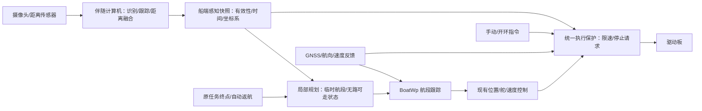

# ArduPilot 目标识别与避障参考调研

核对日期：2026-10-10。范围：本项目 STM32 源码、ArduPilot 官方 Rover/Boat 文档及在线 `master` 源码。本文只做分析，未修改控制代码、未进行仿真或实船验证。在线 master 是开发分支，实施时应固定版本并核对目标板的编译功能。

## 结论

可以继续参考 ArduPilot，尤其适合借鉴“障碍输入 → 安全速度限制 → 路径规划 → 航段跟踪”的分层。目标识别模型和水面感知系统需要另做；读取障碍距离并不意味着已经识别船只、浮标或漂浮物。官方支持使用 Rover 固件控制船，`FRAME_CLASS=2` 为 Boat。[Boat 配置](https://ardupilot.org/rover/docs/boat-configuration.html)

## 官方能力及对应源码

| 功能 | 官方能力 | 本项目参考价值与限制 |
| --- | --- | --- |
| 距离传感器 | `AP_RangeFinder` 提供各类测距设备的驱动和状态接口；`AP_Proximity` 汇集有方向的近障距离和边界 | 可借鉴后端驱动、状态和时间戳；不负责识别目标类别。[RangeFinder 源码](https://github.com/ArduPilot/ardupilot/blob/master/libraries/AP_RangeFinder/AP_RangeFinder.h)、[Proximity 源码](https://github.com/ArduPilot/ardupilot/blob/master/libraries/AP_Proximity/AP_Proximity.h) |
| 简单避碰 | `AC_Avoidance` 目录里的 `AC_Avoid::adjust_speed` 限制期望速度；Rover 官方文档描述除 MANUAL 外各模式尝试在碰撞前停车 | 适合作为第一阶段限速/停推力参考。不能把 Copter 的滑行、俯仰和高度算法照搬到船。[Rover 简单避碰](https://ardupilot.org/rover/docs/common-simple-object-avoidance.html)、[AC_Avoid 接口](https://github.com/ArduPilot/ardupilot/blob/master/libraries/AC_Avoidance/AC_Avoid.h) |
| 局部绕障 | BendyRuler 探测多方向可通行空间，选择趋向目的地的方向；Rover 只支持水平绕行；文档范围为 AUTO、GUIDED、RTL | 最适合当前点到点和自动返航的下一步参考，是局部规划器，不保证最短路。[BendyRuler](https://ardupilot.org/rover/docs/common-oa-bendyruler.html) |
| 围栏规划 | Dijkstra 基于已知围栏和禁入区求路径，文档范围为 AUTO、GUIDED、RTL；单独使用不避开雷达/近障传感器发现的物体，也不支持 Spline Waypoints | 有水域边界、岸线禁区地图时再加，不能替代实时感知。[Dijkstra](https://ardupilot.org/rover/docs/common-oa-dijkstras.html) |
| 组合规划 | `OA_TYPE=3` 先用 Dijkstra 绕围栏，遇近障时切 BendyRuler，近障解除后回 Dijkstra | 有地图和动态感知后参考；先别直接移植整套。[组合规划](https://ardupilot.org/rover/docs/common-oa-dijkstrabendyruler.html) |
| 视觉目标识别 | 官方伴随计算机架构允许外部计算设备接收导航信息、预处理高级传感器并作决策 | 建议视觉推理、跟踪和距离融合放在船载伴随计算机；上述避障模块接收几何信息，不构成现成视觉分类模型。这是依据模块输入接口作出的架构判断。[Companion Computers](https://ardupilot.org/dev/docs/companion-computers.html) |

名称容易混淆：`AP_Avoidance` 是以 `AP_ADSB` 为依赖的移动交通威胁/碰撞风险模块，不能因为名字就当作 Rover 近障规划器。近障安全速度主要看 `libraries/AC_Avoidance/AC_Avoid.*`，航路避障看同目录的 `AP_OAPathPlanner`、`AP_OABendyRuler`、`AP_OADijkstra`、`AP_OADatabase`，跟踪接入看 `AR_WPNav_OA`。[AP_Avoidance 源码](https://github.com/ArduPilot/ardupilot/blob/master/libraries/AP_Avoidance/AP_Avoidance.h)、[规划接口](https://github.com/ArduPilot/ardupilot/blob/master/libraries/AC_Avoidance/AP_OAPathPlanner.h)

## 感知接口需要表达什么

官方 MAVLink `DISTANCE_SENSOR` 表达单方向测距；`OBSTACLE_DISTANCE` 表达最多 72 个角度采样的距离数组，带量程、角间隔、偏角和坐标系。未知、未覆盖、没有障碍需区分，不能统一填成可通行。这些消息没有目标类别或识别置信度。[MAVLink DISTANCE_SENSOR](https://mavlink.io/en/messages/common.html#DISTANCE_SENSOR)、[MAVLink OBSTACLE_DISTANCE](https://mavlink.io/en/messages/common.html#OBSTACLE_DISTANCE)

在线 `AP_Proximity_MAV.cpp` 确认接收 `DISTANCE_SENSOR`、`OBSTACLE_DISTANCE` 和 `OBSTACLE_DISTANCE_3D`，做量程检查并更新近障边界/数据库；数据接收超过 500 ms 会进入 NoData。特别注意：该实现忽略 `OBSTACLE_DISTANCE` 的零距离，三维消息只接受 BODY_FRD；协议定义与接收端实际行为均需测试，不能仅按消息名推定兼容。[MAVLink 后端源码](https://github.com/ArduPilot/ardupilot/blob/master/libraries/AP_Proximity/AP_Proximity_MAV.cpp)

本项目当前使用自定义 JSON，并未自动获得这些 MAVLink 功能。可借鉴数据语义后扩展自己的协议，也可新增独立 MAVLink 感知链路；必须实际实现接收、解析、校验、坐标变换和过期处理。推荐至少包含序列号、采样时间、数据龄期、坐标系、有效视场、距离/方位、传感器健康和质量；目标类别、ID、置信度供任务与显示使用。单目识别框需增加距离来源，才能成为可用于避障的几何障碍。

## 与当前 STM32 工程的衔接

当前代码在 `User/boat/boat_app.h` 明确是 Rover 精简 C 模块，不带 AP_HAL/参数表；`BoatSense` 只有位置、航向、速度及有效性；`boat_wpnav.h` 明确单直线段且不含避障；`User/protocol.h` 的 `PCCommand_t` 尚无障碍输入。因此这次结论是“适合继续参考并扩展”，不是“现在已经支持，只需开启参数”。

建议新增独立障碍快照/健康输入，规划层接在原任务终点与 `BoatWp` 航段之间，保持原任务终点和临时绕障点独立；执行前再有覆盖手动、开环、闭环和自动返航各路径的安全保护。上游 MANUAL 的默认不避障规则是否适用，应由本项目明确选择，不直接继承。

当前 `BoatWp_SetLeg` 重建 S 曲线并重置位置环，不宜让 Qt 高频改原终点模拟规划；临时绕障点到达也不能触发 `main.c` 原终点到达后退手动的逻辑。应借鉴上游 `AR_WPNav_OA` 保存原目的地、单独持有绕障目的地、规划中/错误时减速、避障结束恢复原目标，以及避障活动时不报告最终到达的处理。[AR_WPNav_OA 源码](https://github.com/ArduPilot/ardupilot/blob/master/libraries/AR_WPNav/AR_WPNav_OA.cpp)

`BoatWp_SetSpeed` 有最小 0.05 m/s 和 500 ms 节流，不能把它当急停接口。现有自动输出不含倒车制动，停推力并不代表船立即停住。GNSS、航向、BMS 存在同步读取超时路径，需测控制周期及从采样到驱动的最坏延迟，不能仅根据 100 ms 调度常量声称保证 10 Hz。

上游规划器有后台线程、AHRS/HAL/参数/围栏等依赖，在线实现按约 1 Hz 执行规划并检查结果过期；这说明要将慢速路径规划与快速安全限制分开，不能把上游的结果超时当本船允许的碰撞反应时间。[规划器实现](https://github.com/ArduPilot/ardupilot/blob/master/libraries/AC_Avoidance/AP_OAPathPlanner.cpp)

## 建议实施顺序与验证边界

1. 先打通感知距离、健康、时间戳和遥测，低速验证前方限速与停止请求；通过日志区分传感器报告、STM32 收到、有效障碍状态、期望速度、最终驱动输出。
2. 再做 BendyRuler 思路的局部绕行状态机，验证原任务恢复、临时点到达、左右选择滞回、死路、感知过期、定位失效和返航绕障。
3. 有可靠地图后加围栏规划；视觉分类/跟踪在伴随计算机扩展。运动船只还需速度估计、碰撞时间与会遇策略，不能将一个当前距离点等同于完整动态避碰。

安全距离必须根据本船试验建立：反应延迟内的前进距离、实际减速距离、转弯扫掠范围，加上船体尺寸和测量误差。水面反光、波浪、低矮漂浮物、逆光以及横向水流都应纳入现场验证。官方示例距离参数不是本船标定值。

本地 `E:\无人船\ardupilot` HEAD 为 `9256cd77c5819c2578e50e65e179d8adb5c841f3`，包含 `AR_WPNav_OA.cpp`，但并非完整可用的避障源码集合，未找到的库已用在线官方源码核对。后续移植应固定完整源码版本、检查编译功能及依赖，再做资源/周期预算。有关源码许可，可直接查看各源文件的 GPL v3-or-later 声明，本文不作法律结论。
