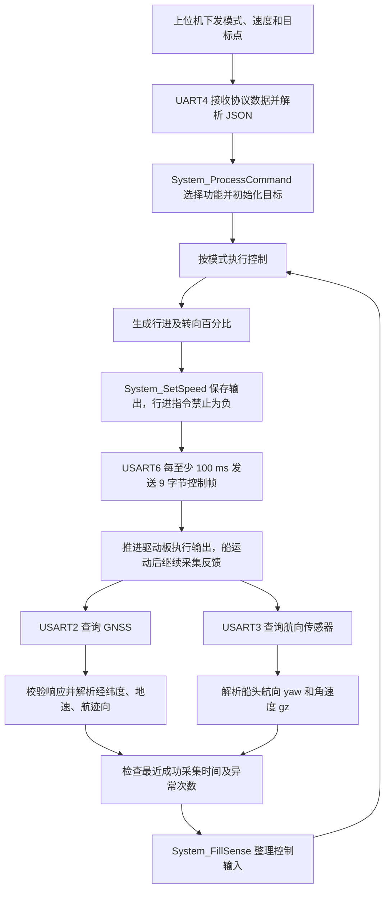
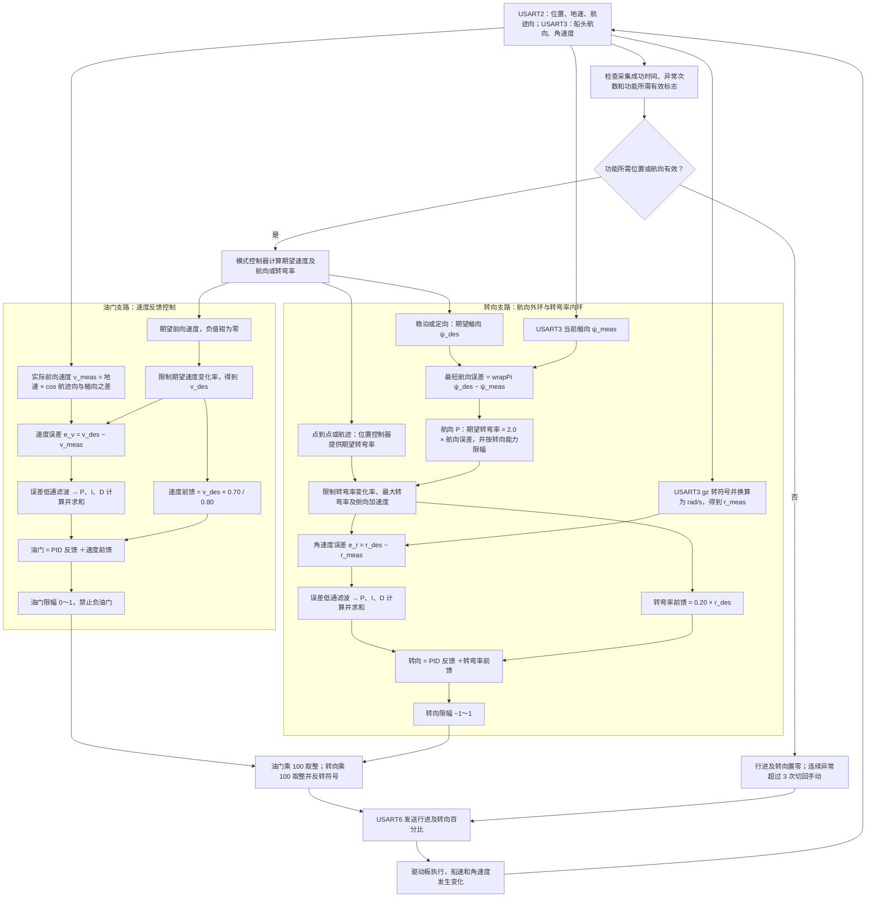
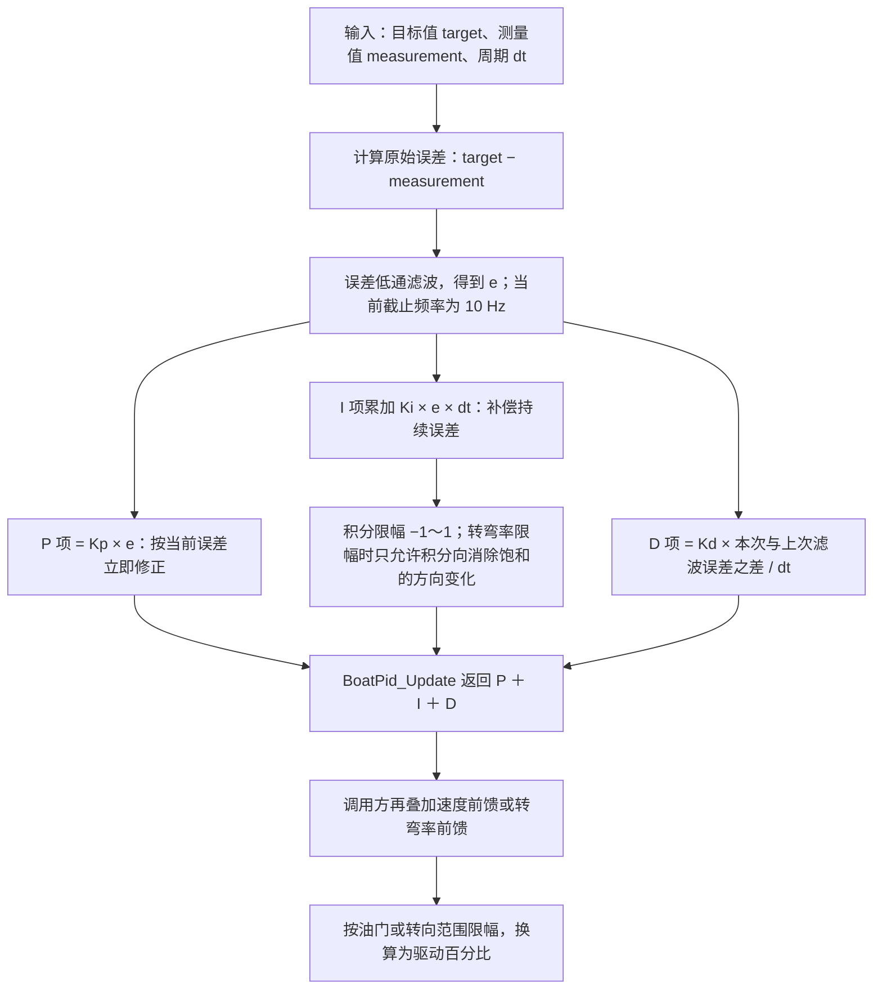
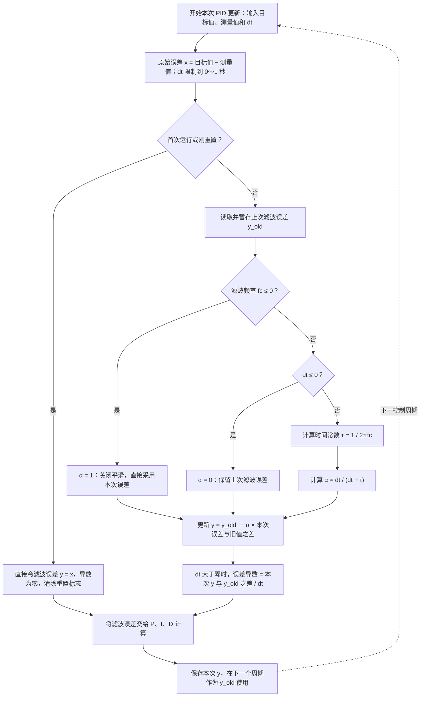
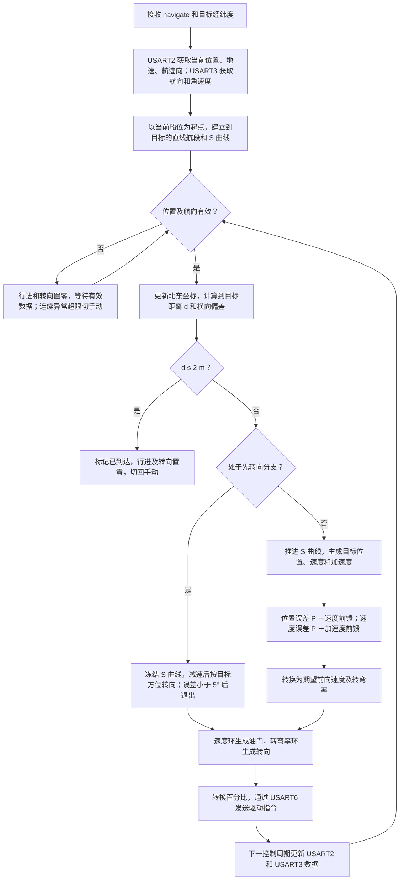
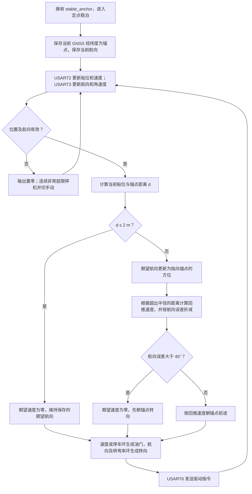
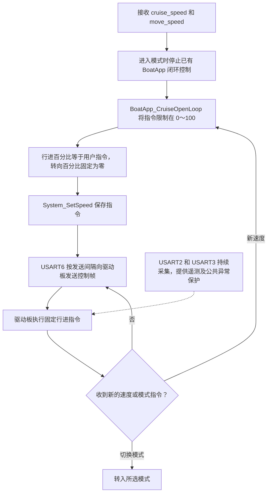
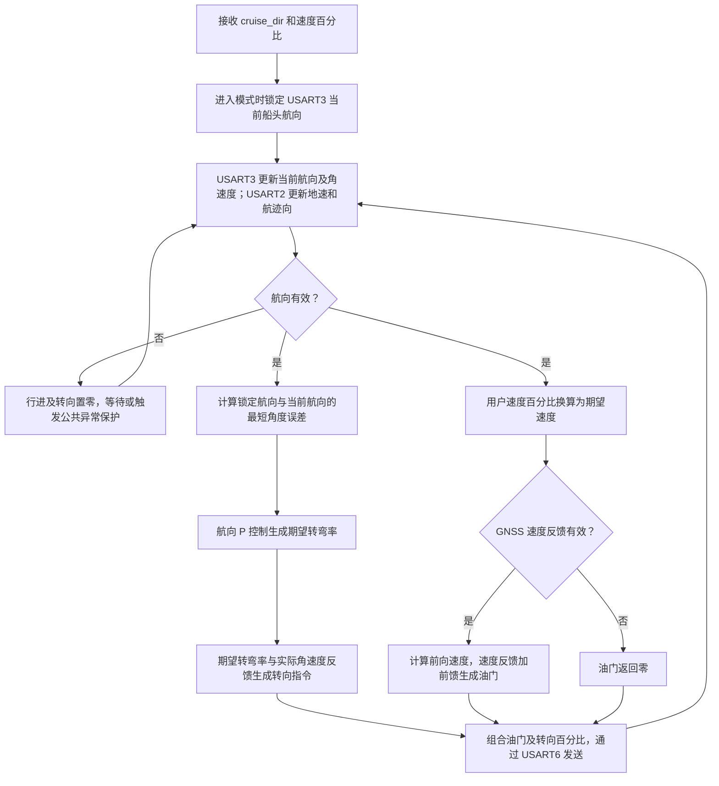
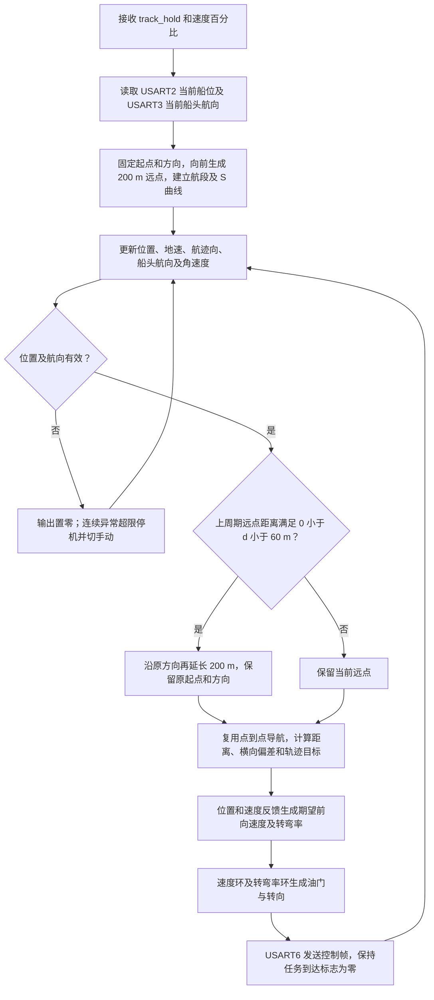

# 无人船五功能实现流程（基于当前 STM32 项目代码）

编写日期：2026-10-07。依据：`STM32F405RGT6/Core/Src/main.c` 和 `STM32F405RGT6/User/boat/` 的当前实现。

本文说明点到点导航、定点稳泊、定速巡航、定向巡航和航迹保持如何从传感器数据生成控制指令。流程图使用 Mermaid，需在支持 Mermaid 的 Markdown 查看器中打开。

**当前执行代码是 STM32 项目中的 `BoatApp`、`BoatModes`、`BoatWp` 等 C 模块。** 控制结构参考 ArduPilot Rover，但本文以这些模块的实际逻辑为准，不把产品说明或工作区中的 ArduPilot 源码当作本固件的直接调用链。

## 1. 五功能共用的数据与输出链路

### 1.1 串口分工

| 接口 | 当前波特率 | 用途 | 控制使用的数据 |
| --- | --- | --- | --- |
| USART2 | 9600 | 通过 RS485 / Modbus 读取 GNSS | 经纬度、对地速度、对地航迹向 |
| USART3 | 115200 | 通过 RS485 / Modbus 读取航向传感器 | 船头航向 `yaw`、航向角速度 `gz` |
| UART4 | 115200 | 控制协议接收与遥测发送 | 模式、速度百分比、目标经纬度等 JSON 字段 |
| USART6 | 9600 | 向推进驱动板发送控制帧 | 行进百分比、转向百分比 |

**船头航向和对地航迹向用途不同：** USART3 的 `yaw` 表示船头朝向，用于航向控制；USART2 的 `yaw` 在本项目中作为对地航迹向，用于分解对地速度。横流下，两者可能不同。

主循环按至少 50 ms 的间隔轮流查询 GNSS 和航向传感器，理想情况下每种传感器约 100 ms 查询一次。闭环控制和驱动指令发送均按至少 100 ms 的间隔执行，遥测发送间隔为 200 ms。由于查询有阻塞等待，这些是调度间隔，不代表每次都能严格准时运行。



### 1.2 有效数据与公共控制环

GNSS 仅解析满足长度、地址、功能码、数据字节数、CRC 且无 UART 错误的完整响应；通信失败保留上次数据。主循环要求最近成功采集距今不超过 500 ms，且连续异常次数不超过 3。GNSS 经纬度同时为零时不作为有效定位。GNSS 或航向连续异常超过 3 次时，主循环停止输出并切回手动。

闭环功能会根据自身需要检查有效标志：点到点、稳泊和航迹保持要求位置及航向有效；定向巡航要求航向有效，而油门速度环还需要有效 GNSS 速度，缺少速度反馈时油门返回零。定速巡航不使用传感器闭环，但仍受主循环的公共保护逻辑影响。

闭环功能使用以下公共控制过程：

- **速度反馈：** GNSS 地速由 km/h 除以 3.6 换算为 m/s，根据航迹向分解为北、东速度，再按船头航向投影为前向速度：`前向速度 = 地速 × cos(航迹向 − 船头航向)`。
- **油门控制：** 期望速度经过变化率限制，前馈油门叠加速度误差 PID，输出限制在 `0～1`。当前速度 PID 的 D 参数为零，实际采用 PI 反馈。
- **转向控制：** 定向和稳泊先用航向误差 P 控制得到期望转弯率；点到点和航迹保持由位置控制器生成期望转弯率。随后用期望转弯率与实际角速度的误差进行 PID 控制并叠加前馈，当前 D 参数同样为零。
- **输出换算：** 油门换算为 `0～100`，转向换算为 `−100～100`，并转换符号使驱动板指令正值表示左转。

#### 公共控制环：从传感器反馈到油门、转向输出

下面将油门和转向画成两条控制支路。**航向外环使用 P 控制，速度环和转弯率内环调用 PID 模块；当前两者的 D 均为零，实际输出为 PI 反馈叠加前馈。** 点到点和航迹保持通常由位置控制器直接提供期望转弯率；先转向分支则根据目标方位生成转弯率。



图中的速度支路表示正常速度控制。期望速度为零时调用 `BoatAttitude_ThrottleStop()`：先按变化率限制减速，满足停车判定后清除速度积分并输出零油门；点到点到达则直接把油门和转向置零。GNSS 速度反馈无效时，速度环直接返回零油门，转向支路仍按自身有效性判断执行。

#### PID 模块内部：误差如何变成控制输出

`BoatPid_Update()` 先计算目标值与测量值之差，再对误差低通滤波。下面的 `e` 表示滤波后的误差；首次运行或重置后的第一次计算直接初始化误差，D 项设为零。



#### 低通滤波：本次误差与上次滤波结果如何合成

当前 `boat_pid.c` 使用**一阶递推低通滤波**，滤波对象是速度或转弯率的控制误差。它不直接滤波 GNSS 经纬度，也不单独滤波目标值或测量值。

每个控制周期计算：

```text
原始误差 x[k] = 本次目标值 − 本次测量值
时间常数 τ = 1 / (2π × fc)
滤波系数 α = dt / (dt + τ)
本次滤波误差 y[k] = y[k−1] + α × (x[k] − y[k−1])
                 = (1−α) × y[k−1] + α × x[k]
```

`fc` 是配置的滤波频率，当前速度环及转弯率环均为 `10 Hz`；`dt` 是本次控制周期，单位为秒。速度环的误差单位为 m/s，转弯率环为 rad/s，滤波前后单位不变。两个 PID 对象各自保存自己的上次滤波误差。



其含义是：**保留一部分旧误差，再加入一部分新误差，减少误差突变对控制输出的影响。** `α` 越接近 1，跟随新误差越快；越接近 0，平滑越强，但响应越慢。

按典型控制周期 `dt = 0.1 s` 和当前参数 `fc = 10 Hz`：`τ ≈ 0.0159 s`，`α ≈ 0.8627`。本次结果约为 **13.73% 的旧值＋86.27% 的新误差**，因此当前参数下平滑作用较弱。

例如速度环已经运行，上次滤波误差为零，原始误差突然变为 `0.4 m/s`，之后保持不变：

| 周期 | 本次原始误差 x | 上次滤波误差 | 本次滤波误差 y |
| --- | --- | --- | --- |
| 第 1 次变化 | 0.4000 | 0.0000 | 0.3451 |
| 第 2 次 | 0.4000 | 0.3451 | 0.3925 |
| 第 3 次 | 0.4000 | 0.3925 | 0.3990 |

原始误差直接从零跳到 0.4，滤波误差则逐步接近 0.4。这里是演示递推过程的假设数据；若是 PID 重置后的第一次更新，代码直接采用 0.4，不经过上述渐变。

`10 Hz` 是代码计算时间常数所用的配置值。控制典型更新频率约为 10 次/秒，不能据此宣称实际能准确处理 10 Hz 的误差波动；实际平滑强度应结合更新周期和上述 `α` 判断。代码也没有先滤波前馈支路，前馈仍根据目标值计算。

源码对应：`filt_alpha()` 计算系数，`BoatPid_Update()` 中的 `pid->error += filt_alpha(dt, pid->filt_e_hz) * (raw_error - pid->error)` 完成误差更新。

| 控制环 | 目标值与反馈值 | 当前参数 | 输出去向 |
| --- | --- | --- | --- |
| 航向外环 | 期望艏向与实际艏向 | `Kp = 2.00`，仅 P 控制，误差使用弧度 | 期望转弯率，单位 rad/s |
| 转弯率内环 | 限制后的期望转弯率与实际角速度 | `Kp = 0.20`、`Ki = 0.20`、`Kd = 0`、`Kff = 0.20` | 转向 `−1～1`，再转换为百分比 |
| 速度环 | 限制后的期望前向速度与实际前向速度 | `Kp = 0.20`、`Ki = 0.20`、`Kd = 0`；速度前馈系数为 `0.70 / 0.80` | 油门 `0～1`，再转换为百分比 |

转弯率控制向 PID 传入转弯率限制标志，用于抑制同方向积分增长。速度控制当前传入的限制标志固定为零，因此只有积分幅值限制，油门输出饱和不会通过该标志抑制积分增长。两条支路最终的输出限幅都在叠加前馈后执行。

例如期望前向速度为 `0.6 m/s` 时，速度前馈油门为 `0.6 × 0.70 / 0.80 = 0.525`。再叠加速度 PI 的修正量，并限制到 `0～1`，才得到最终油门；它不是直接固定输出 52.5%。转向同样由角速度 PI 修正量与转弯率前馈相加后得到。

STM32 本项目发送的是串口控制帧：`55 00 00 00 行进 转向 00 00 AA`。PWM 或推进器输出由外部驱动板执行，本文不将其描述成 STM32 本工程直接输出 PWM。

## 2. 功能一：点到点导航

### 实现说明

用户下发 `control_mode = navigate` 和目标经纬度。主循环以当前 GNSS 位置为航段起点，调用 `BoatApp_EnterWaypoint()` 建立从当前位置到目标点的直线航段。

**当前实现采用 S 曲线轨迹规划＋位置/速度反馈控制。** `BoatScurve` 沿航段生成随时间推进的目标位置、速度和加速度；`BoatPos` 根据实际位置与轨迹目标的误差进行修正，再生成期望前向速度和转弯率。

控制器将经纬度转换为以航段起点为原点的局部北东坐标，计算到终点距离和横向偏差。位置误差乘 P 后叠加轨迹速度前馈，得到期望北东速度；速度误差乘 P 后叠加加速度前馈，得到期望北东加速度。转换到船体坐标后，前向分量用于速度控制，侧向加速度用于生成转弯率。

进入航段时，如果船头与目标方向相差超过 45°，进入先减速、再转向的分支，冻结 S 曲线推进；误差小于 5° 后退出该分支，再沿航段前进。这描述的是控制指令，实际能否原地转动取决于驱动板和推进布局。

**到达条件为当前船位到终点的距离 `d ≤ 2 m`。** 即使越过终点，若仍在 2 m 圈外，也不算到达。到达后立即将行进、转向置零，记录到达状态并切回手动，不自动进入稳泊。同一已到达目标连续重复下发时，主循环抑制重新启动。



计算关系为：`期望速度 = 位置误差 × BOAT_PSC_POS_P + 轨迹速度`，`期望加速度 = 速度误差 × BOAT_PSC_VEL_P + 轨迹加速度`。

当前航段最高速度默认 `0.6 m/s`；非零用户速度百分比按 `百分比 / 100 × 1.0 m/s` 换算，并与默认值取较小值。用户值为零时仍使用默认航速，因此该模式下把速度滑条拉到零并不等于取消导航。

代码入口：`main.c::System_ProcessCommand()` → `BoatApp_EnterWaypoint()` → `BoatModes_WaypointUpdate()` → `BoatWp_Update()` → `BoatScurve_Advance()` / `BoatPos_Update()` → `BoatAttitude` → `main.c::System_SendDriverCommand()`。

## 3. 功能二：定点稳泊

### 实现说明

用户切换到 `control_mode = stable_anchor` 时，`BoatApp_EnterLoiter()` 保存**切换时的当前经纬度**作为锚点，并记录当前船头航向。锚点不是上一次导航目标。

每周期利用 USART2 获取的船位计算离锚点距离 `d`：

- **圈内 `d ≤ 2 m`：** 期望速度设为零，进入减速停车逻辑，维持保存的期望航向。停车有速度变化率限制，因此并非刚进入圈内就必然立即零油门。
- **圈外 `d > 2 m`：** 计算船位指向锚点的方位，更新期望航向；回推速度为 `min((d − 2) × 0.5, 0.6) × 航向折减系数`，单位 m/s。
- 航向折减系数为 `1 − 0.5 × clamp(|航向误差| / 90, 0, 1)`。误差超过 45° 时，期望前进速度直接设为零，先转向锚点，再前进回推；不生成倒车油门。

圈外期望航向会随锚点方位更新，再进入圈内时维持最近一次保存的期望航向，不一定始终是首次开启稳泊时的航向。顶流效果来自位置偏差产生回推速度、速度反馈调节油门，代码没有单独估计水流方向或流速。



稳泊不会因进入 2 m 圈而结束；只要模式继续保持，就持续判断漂移并修正。

代码入口：`BoatApp_EnterLoiter()` → `BoatModes_LoiterEnter()` → `BoatModes_LoiterUpdate()` → `BoatAttitude_ThrottleFromSpeed()` / `BoatAttitude_ThrottleStop()` / `BoatAttitude_SteerFromHeading()`。

## 4. 功能三：定速巡航

### 实现说明

用户下发 `control_mode = cruise_speed` 后，调用 `BoatApp_CruiseOpenLoop()`，将 `move_speed` 限制在 `0～100`，直接作为行进百分比，转向百分比固定为零。

**此功能在当前代码中是固定油门开环巡航。** GNSS 对地速度和航向数据继续采集、上报，但不用于调整该功能的行进或转向输出。速度百分比为 50 时，发送行进指令 50、转向指令 0；不表示实际对地速度一定为 0.5 m/s。



该功能不锁定绝对船头航向，也不修正横向偏移；风、流和负载变化会改变实际航速。断连、低电量及传感器连续异常等公共保护仍可能改变输出或切换模式。

代码入口：`main.c::System_ProcessCommand()` → `BoatApp_CruiseOpenLoop()` → `System_SetSpeed()` → `System_SendDriverCommand()`。

## 5. 功能四：定向巡航

### 实现说明

用户切换到 `control_mode = cruise_dir` 时，`BoatApp_EnterHeading()` 将 USART3 最近取得的**当前船头航向**锁定为目标航向；当前入口没有使用用户另行指定的目标角度。后续同模式的速度更新只改变期望速度，不重新锁定航向。

每周期计算最短航向误差 `wrap180(锁定航向 − 当前航向)`，航向 P 控制生成期望转弯率，再结合 USART3 的角速度反馈生成转向指令。期望速度为 `速度百分比 / 100 × 1.0 m/s`，由 USART2 的地速、航迹向及当前艏向计算实际前向速度，速度环生成油门。



定向巡航维持船头朝向，不建立固定地面航线。因此即使航向保持正确，横流仍可能让船整体侧移。

代码入口：`BoatApp_EnterHeading()` → `BoatModes_HeadingEnter()` → `BoatModes_HeadingUpdate()` → `BoatAttitude_SteerFromHeading()` / `BoatAttitude_ThrottleFromSpeed()`。

## 6. 功能五：航迹保持

### 实现说明

用户切换到 `control_mode = track_hold` 时，取得 USART2 的当前位置和 USART3 的当前船头航向。以当前位置为固定起点，沿当前船头方向向前生成 **200 m 远点**，建立一条地面直线航段。

之后复用点到点的 S 曲线规划和位置/速度反馈控制，根据船位偏差修正行进及转向。它关注实际船位是否贴合进入时建立的直线，因而在横流下可通过改变船头方向来修正侧移。

当上一周期保存的远点距离满足 `0 < d < 60 m` 时，沿原始方向把航段再延长 **200 m**；起点和航段方向保持不变。远点只是持续航行的控制目标，不是任务完成终点；`BoatApp_Update()` 在此模式下将到达标志保持为零，不按点到点的到达逻辑切回手动。



航迹保持和点到点使用相同的航速设置规则：默认上限 `0.6 m/s`，非零用户速度可降低此上限，零值仍采用默认航速。退出需切换模式或由公共保护逻辑接管。

代码入口：`BoatApp_EnterTrack()` → `BoatMath_Offset()` / `BoatWp_SetLeg()` → `BoatModes_TrackUpdate()` → `BoatWp_Extend()` / `BoatModes_WaypointUpdate()`。

## 7. 五功能对照与源码索引

| 功能 | 核心目标 | 控制方法 | 完成或持续条件 |
| --- | --- | --- | --- |
| 点到点导航 | 驶向指定经纬度 | S 曲线＋位置/速度反馈＋速度/转弯率环 | 距目标 ≤ 2 m：输出归零并切手动 |
| 定点稳泊 | 保持进入时的锚点附近 | 圈内停车、圈外朝锚点回推，航向及速度闭环 | 持续运行，圈内外反复判断 |
| 定速巡航 | 保持用户行进百分比 | 固定油门开环，转向为零 | 速度或模式指令更新、保护接管 |
| 定向巡航 | 保持进入时的船头航向 | 航向与转弯率反馈＋速度反馈 | 持续运行，不修正地面横向位置 |
| 航迹保持 | 沿进入时确定的地面直线行驶 | 复用点到点控制，持续延长远点 | 持续运行，不以远点到达结束 |

以下链接均相对于本文所在的项目根目录：

- [主循环、模式切换、传感器有效性与驱动帧发送](STM32F405RGT6/Core/Src/main.c)
- [串口配置](STM32F405RGT6/Core/Src/usart.c)
- [GNSS 读取与校验](STM32F405RGT6/User/gnss_sensor.c)
- [航向及角速度读取](STM32F405RGT6/User/heading_sensor.c)
- [控制协议及模式字符串](STM32F405RGT6/User/protocol.c)
- [功能入口、传感器状态转换及输出换算](STM32F405RGT6/User/boat/boat_app.c)
- [四个闭环功能的模式控制](STM32F405RGT6/User/boat/boat_modes.c)
- [航段、到点判定及远点延长](STM32F405RGT6/User/boat/boat_wpnav.c)
- [S 曲线规划](STM32F405RGT6/User/boat/boat_scurve.c)
- [位置与速度反馈控制](STM32F405RGT6/User/boat/boat_pos.c)
- [航向、转弯率及油门控制](STM32F405RGT6/User/boat/boat_attitude.c)
- [半径、速度及控制器参数](STM32F405RGT6/User/boat/boat_config.h)

本文根据当前源代码整理，描述软件控制逻辑；到点精度、稳泊效果及驱动板执行情况仍需以实船验证为准。
